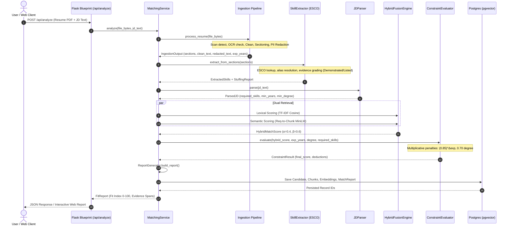

# ResumeFit Technical Architecture & Implementation Blueprint

This document details the architectural design, component contracts, and pipeline-to-code mapping of **ResumeFit**, an explainable, auditable hybrid resume–job description matching system.

---

## 1. Architectural Principles

ResumeFit is architected around five core principles:
1. **Explainability Over Generative Mystery:** Scoring is 100% deterministic, decomposed, and auditable. No generative LLMs are used in the scoring, feature extraction, or justification paths.
2. **Dual-Retrieval Symmetry:** Lexical matching captures exact technical specifications and domain acronyms; semantic matching captures conceptual and functional alignments.
3. **Taxonomy Grounding:** Skills and qualifications map to official **ESCO v1.2.1** standards augmented with transparent, version-controlled alias overlays.
4. **Traceable Evidence:** Every extracted skill is classified into one of three evidence tiers (*Demonstrated*, *Listed-only*, *Tentative*) with exact character offsets linked to the original document.
5. **Privacy and Audit Integrity:** Mandatory pre-embedding PII redaction and native cascading right-to-erasure.

---

## 2. Component Pipeline to Codebase Mapping

```
ResumeFit Core Architecture
├── Ingestion & Hygiene       -> core/ingestion/
├── Skill Extraction & ESCO   -> core/skills/
├── Job Description Parser    -> core/jd/
├── Retrieval & Matching      -> core/matching/
├── Explainability Engine     -> core/explain/
├── Persistence Layer         -> core/db/
├── Orchestration Service     -> resumefit/services.py
└── Presentation (API & Web)  -> resumefit/api/, resumefit/web/
```

### 2.1 Ingestion & Hygiene (`core/ingestion/`)
* **`scan_detect.py`**: Enforces strict magic-byte validation (`%PDF-`), verifies document encryption (`is_encrypted`), checks size ($\le 5\text{MB}$) and page limits ($\le 10$ pages), and detects image-only/scanned documents using character density heuristics ($< 50$ chars/page). Unsupported documents raise typed `UnsupportedDocument` exceptions.
* **`extract.py`**: Employs a dual-extractor cascade: tries `pdfplumber` for layout-aware bounding-box text extraction; falls back to `pypdf` if extraction quality drops below acceptable thresholds.
* **`preprocess.py`**: Normalizes Unicode ligatures (`fi` $\rightarrow$ `fi`), strips control characters, repairs soft hyphens (`de-vel-op-ment` $\rightarrow$ `development`), unifies disparate bullet styles (`•`, `–`, `*`), and rejoins wrapped lines.
* **`sections.py`**: Identifies standardized resume sections (`EXPERIENCE`, `EDUCATION`, `SKILLS`, `PROJECTS`, `SUMMARY`, `CERTIFICATIONS`) via regex heading dictionaries and fallback font-size / character-offset heuristics. Parses employment date ranges (`Jan 2021 – Present`, `2018–2020`) and merges overlapping periods into total verified experience years.
* **`pii.py`**: Scrubbing engine combining spaCy NER (`PERSON`, `ORG`) with precision regex patterns (`EMAIL`, `PHONE`, `URL`). Produces dual outputs: redacted text for embedding/logging and unredacted text for skill extraction.

### 2.2 Skill Extraction & Taxonomy (`core/skills/`)
* **`esco_loader.py`**: Loads normalized ESCO v1.2.1 CSV datasets (`skills_en.csv`, `skillSkillRelations.csv`, `occupations_en.csv`) into structured, hashed in-memory collections indexed by URI and preferred label.
* **`aliases.py`**: Loads `data/aliases.yaml` (314 entries) to resolve contemporary tech terminology (`k8s` $\rightarrow$ `Kubernetes`, `react.js` $\rightarrow$ `React (computer programming)`).
* **`extractor.py`**: Multi-phase skill extraction cascade:
  1. *Exact string matching* against canonical ESCO labels.
  2. *Alias lookup* across common frameworks, libraries, and tools.
  3. *Fuzzy matching* (via RapidFuzz) protected by strict guards: minimum token length $\ge 3$ characters and context regex guards for ambiguous single-letter tokens (`C`, `R`, `Go`).
* **`evidence.py`**: Classifies candidate skills into three verified tiers:
  * **Demonstrated:** Skill mentioned within `EXPERIENCE` or `PROJECTS` alongside action verbs and metrics.
  * **Listed-only:** Skill appears solely in a dedicated `SKILLS` keyword block without contextual corroboration.
  * **Tentative:** Skill extracted with lower confidence or fuzzy match threshold.
  Calculates the **Keyword Stuffing Ratio** ($\text{Listed} / \text{Demonstrated}$); ratios $> 3.0$ trigger integrity penalties.

### 2.3 Job Description Parsing (`core/jd/`)
* **`parser.py`**: Parses free-form job specifications into structured `ParsedJD` objects:
  * Distinguishes **Required** vs. **Preferred** skills using modal header analysis (`Requirements`, `Must-have` vs. `Nice to have`, `Bonus`).
  * Extracts minimum experience tenure via numerical regex patterns (`5+ years`, `at least 3 years`).
  * Classifies minimum education requirements (`Bachelor's`, `Master's`, `PhD`).

### 2.4 Retrieval & Matching Engine (`core/matching/`)
* **`chunking.py`**: Token-aware section chunking respecting structural document boundaries. Chunks are constrained to $\le 200$ tokens with a 30-token sliding overlap. Chunks never bridge across distinct resume sections.
* **`lexical.py`**: TF-IDF cosine similarity engine using a pre-fitted, frozen reference vocabulary of 2,685 terms (`data/artifacts/tfidf_reference.joblib`). Employs a custom technical tokenizer preserving compound punctuation (`c++`, `node.js`, `.net`, `ci/cd`).
* **`semantic.py`**: Dual-mode neural similarity using `sentence-transformers/all-MiniLM-L6-v2`:
  * Mode A: Global mean-pooled section cosine similarity.
  * Mode B: Requirement-to-chunk matching. For each JD requirement, computes maximum cosine alignment across chunks weighted by section importance (`experience`: 1.0, `projects`: 0.9, `skills`: 0.5, `education`: 0.4).
* **`normalize.py`**: Maps raw cosines to a calibrated $[0.0, 1.0]$ interval using percentile calibration against pre-computed empirical score distributions.
* **`hybrid.py`**: Computes convex linear fusion ($S_{\text{hybrid}} = \alpha \cdot S_{\text{lex}} + \beta \cdot S_{\text{sem}}$) with defaults $\alpha=0.4, \beta=0.6$. Also supports Reciprocal Rank Fusion ($k=60$).
* **`constraints.py`**: Evaluates hard and soft eligibility rules. In default soft mode, applies itemized multiplicative penalties:
  * Experience deficit: $(0.85)^{\Delta\text{years}}$
  * Degree deficit: $0.70\times$
  * Missing must-have skill: $0.80\times$
  * Keyword stuffing flag: $0.85\times$
* **`rerank.py`**: Optional cross-encoder reranker (`cross-encoder/ms-marco-MiniLM-L-6-v2`), disabled by default for low-latency CPU operation.

### 2.5 Explainability & Reporting (`core/explain/`)
* **`report.py`**: Aggregates all evaluation artifacts into a typed, JSON-serializable `FitReport`. Generates deterministic natural language summaries explaining the Fit Index ($0$–$100$), matched/missing competencies, and itemized penalty justifications.

### 2.6 Persistence & Vector Database (`core/db/`)
* **`models.py`**: SQLAlchemy 2.0 ORM models (`CandidateResume`, `ResumeChunk`, `CandidateSkill`, `JobDescription`, `MatchReport`).
* **`migrations/`**: Alembic schema migrations featuring:
  * `vector(384)` embeddings indexed with **pgvector HNSW** (`m=16`, `ef_construction=64`, metric: `cosine`).
  * `tsvector` column on resume and JD text indexed with PostgreSQL **GIN** for full-text search.
  * Cascading foreign keys (`ON DELETE CASCADE`) enforcing GDPR Right-to-Erasure.
* **`repo.py`**: Dual-engine repository supporting PostgreSQL 15 + pgvector for production and an in-memory SQLite + NumPy fallback for hermetic offline testing.

---

## 3. Request Flow Sequence Diagram



---

## 4. Security, Memory Budget & Latency Profile

| Metric / Dimension | Specification / Guarantee | Design Rationale |
|---|---|---|
| **Memory Footprint** | $\approx 420\text{ MB}$ (Single Worker) | PyTorch CPU-only wheels + lightweight 22M parameter MiniLM model |
| **Cold-Start Delay** | $< 1.5\text{ seconds}$ | Models and reference TF-IDF matrix pre-cached during Docker build |
| **Inference Latency** | $\approx 220\text{ ms}$ / resume | Vectorized numpy cosine calculations; zero GPU dependency |
| **Input Validation** | Reject $> 5\text{ MB}$, $> 10$ pages | Prevents ReDoS and decompression memory exhaustion |
| **PII Scrubbing** | Names, phones, emails redacted | Embeddings never receive raw identifying candidate PII |
| **Right-to-Erasure** | Immediate cascading deletion | Zero orphan chunks or audit vectors retained in vector index |
